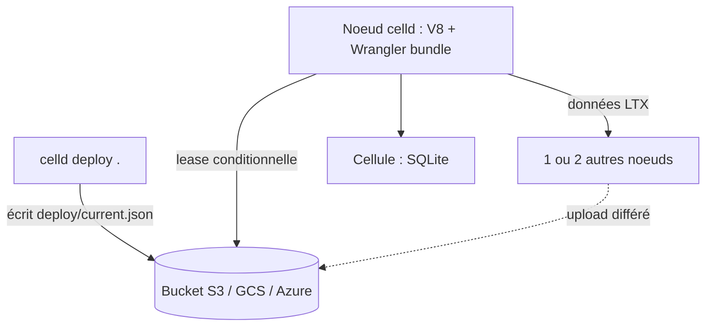

# denoland/celld

> Démon qui exécute des applications Cloudflare Workers et Durable Objects sur tes propres machines, avec un stockage S3.

## Le problème
Les Durable Objects, KV, Queues et D1 de Cloudflare enferment l'application sur leur réseau ; les faire tourner chez soi demande de reconstruire tout cela.

## Ce que ça fait vraiment
Chaque nœud embarque V8, exécute les bundles Wrangler et déploie depuis ton `wrangler.json`. Chaque objet est une cellule avec sa propre base SQLite, dont l'état durable est dans un bucket S3, GCS ou Azure Blob. Une écriture conditionnelle sur le bucket donne la propriété d'une cellule ; il n'y a ni consensus ni plan de contrôle.

## Comment c'est branché


## Essayer
```bash
curl -fsSL https://celld.dev/install.sh | sh
celld dev
celld deploy . --bucket s3://my-cells-bucket
```

## Coût et pièges
Licence Apache 2.0. Il faut un bucket compatible S3, GCS ou Azure, et `esbuild` dans le `PATH` pour les Workers. Un nœud seul attend le bucket à chaque écriture (environ 90 ms en région locale, jusqu'à 600 ms mesurés ailleurs) : prévoir au moins deux nœuds. Le port interne doit rester sur un réseau privé.

## Ce que ce n'est pas
Ce n'est pas Cloudflare : tout ce qui exige leur réseau, un GPU ou un parc de navigateurs est hors périmètre. Les conteneurs sont expérimentaux, et les pull requests sont désactivées (patch par e-mail).

## Alternatives
Le README ne cite pas d'alternative nommée.

## Pour toi
À surveiller : intéressant si tu héberges déjà des Workers et veux de l'état durable sans Cloudflare, mais hors de ton cœur de métier data et IA.

