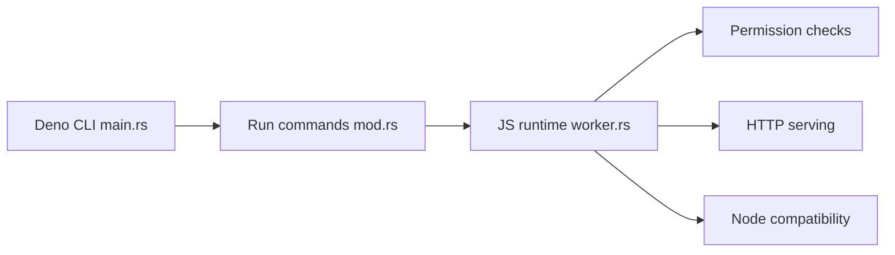

# denoland/deno

> A JavaScript, TypeScript and WebAssembly runtime, secure by default, written in Rust.

## The problem
Node.js grants all rights to code by default and requires separate TypeScript tooling.

## What it actually does
A single CLI runs JS and TS on V8, with an explicit permission system (`--allow-net`). It provides an HTTP server (`Deno.serve`), fetch, WebGPU, Node compatibility, SQLite, cache, a language server, a test runner and OpenTelemetry. The standard library and the JSR registry are related projects.

## How it is wired


## Trying it
```bash
curl -fsSL https://deno.land/install.sh | sh
```
Then, in `server.ts`: `Deno.serve((_req: Request) => new Response("Hello, world!"));`
```bash
deno run --allow-net server.ts
```

## Cost and gotchas
Free. Rights are granted at run time, which means you have to think about them. Node compatibility is presented as a feature, with no guarantee of completeness.

## What it is not
Not a data or AI tool. Not a guaranteed replacement for Node for every package.

## Alternatives
No alternative named in the README.

## For you
Worth watching: interesting for safe web tools or TypeScript scripts, outside the core of data or ML work.
