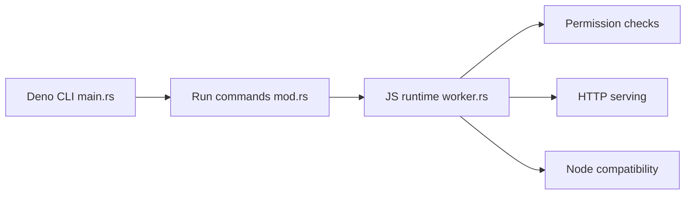

# denoland/deno

> Environnement d'exécution JavaScript, TypeScript et WebAssembly, sécurisé par défaut, écrit en Rust.

## Le problème
Node.js donne par défaut tous les droits au code et demande un outillage TypeScript séparé.

## Ce que ça fait vraiment
Une seule CLI exécute JS et TS sur V8, avec un système de permissions explicites (`--allow-net`). Elle fournit un serveur HTTP (`Deno.serve`), fetch, WebGPU, compatibilité Node, SQLite, cache, serveur de langage, lanceur de tests et OpenTelemetry. La bibliothèque standard et le registre JSR sont des projets liés.

## Comment c'est branché


## Essayer
```bash
curl -fsSL https://deno.land/install.sh | sh
```
Puis, dans `server.ts` : `Deno.serve((_req: Request) => new Response("Hello, world!"));`
```bash
deno run --allow-net server.ts
```

## Coût et pièges
Gratuit. Les droits se donnent à l'exécution, ce qui impose d'y penser. La compatibilité Node est présentée comme une fonction, sans garantie complète.

## Ce que ce n'est pas
Pas un outil de données ni d'IA. Pas un remplaçant garanti de Node pour tout paquet.

## Alternatives
Aucune alternative nommée dans le README.

## Pour toi
À surveiller : intéressant pour des outils web ou scripts TypeScript sûrs, hors cœur de métier data ou ML.

