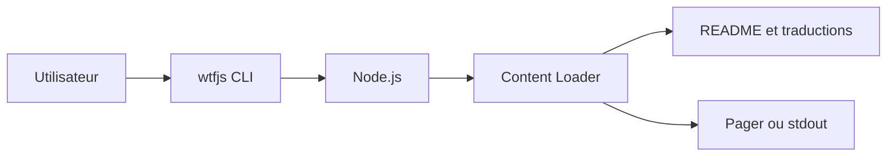

# denysdovhan/wtfjs

> Collection of confusing JavaScript examples, each one explained, for developers curious about the corners of the language.

## The problem
JavaScript's coercion and comparison rules produce counter-intuitive results that you discover in production.

## What it actually does
The README is a manual: each example shows an expression (`[] == ![]`, `NaN === NaN`, `parseInt(null, 24)`), its result, then an explanation with a pointer to the relevant section of the ECMAScript specification. It exists in several translations and also installs as an npm package that opens the text in `$PAGER`.

## How it is wired


## Trying it
```bash
npm install -g wtfjs
wtfjs
```

## Cost and gotchas
Free. Several examples depend on old engines (V8 v5.5 bug, IE11): read the environment note on each case.

## What it is not
It is not a best-practices guide or a structured course; translations may lag behind the English, as the README points out.

## Alternatives
No alternative named in the README (it cites wtfjs.com and the "Wat" talk as readings).

## For you
Worth watching: useful reading if you write JavaScript from time to time, unrelated to your core data/AI work.
