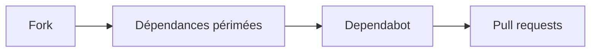

# dependabot/demo

> Demo repository with outdated dependencies, to be forked in order to try Dependabot.

## The problem
Testing Dependabot requires a project with obsolete dependencies.

## What it actually does
Contains a few projects with deliberately old dependencies. The README is two lines long: you fork and observe. Nothing else is documented.

## How it is wired

## Trying it
No documented command: fork the repository on GitHub.

## Cost and gotchas
Free, GitHub account required. License not declared.

## What it is not
Not code to reuse; it is outdated on purpose.

## Alternatives
No alternative named in the README.

## For you
Ignore: you will enable Dependabot directly on your own repositories without this sandbox.
