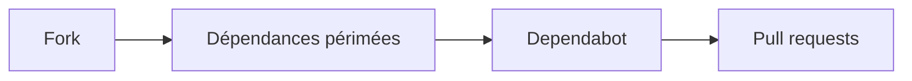

# dependabot/demo

> Dépôt de démonstration avec des dépendances périmées, à forker pour essayer Dependabot.

## Le problème
Tester Dependabot demande un projet avec des dépendances obsolètes.

## Ce que ça fait vraiment
Contient quelques projets aux dépendances volontairement anciennes. Le README tient en deux lignes : on forke et on observe. Rien d'autre n'est documenté.

## Comment c'est branché

## Essayer
Aucune commande documentée : forker le dépôt sur GitHub.

## Coût et pièges
Gratuit, compte GitHub requis. Licence non déclarée.

## Ce que ce n'est pas
Pas du code à réutiliser ; il est périmé à dessein.

## Alternatives
Aucune alternative nommée dans le README.

## Pour toi
À ignorer : tu activeras Dependabot directement sur tes dépôts sans ce bac à sable.

