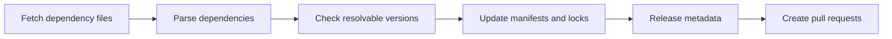

# dependabot/dependabot-core

> Ruby library for dependency updates, to host your own Dependabot.

## The problem
Dependencies age and vulnerabilities pile up without automated updates.

## What it actually does
Finds the latest resolvable version of a dependency, regenerates manifests and lockfiles, and writes the PR description with changelogs. Covers about a dozen ecosystems plus Docker, Terraform and git submodules. It is only a library: you need an entry point (Dependabot CLI recommended).

## How it is wired


## Trying it
```bash
docker pull ghcr.io/dependabot/dependabot-updater-gomod
bin/docker-dev-shell go_modules
bin/dry-run.rb go_modules rsc/quote
```

## Cost and gotchas
Free. Disposable environment required (arbitrary code from manifests). The CLI produces diffs, not PRs: you wire that yourself.

## What it is not
Not the turnkey GitHub service: that one is enabled via `dependabot.yml`.

## Alternatives
- Dependabot CLI: recommended entry point for standalone use.

## For you
Keep an eye on it: useful only if you self-host dependency updates; otherwise the GitHub service is enough.
