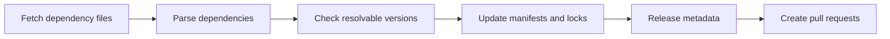

# dependabot/dependabot-core

> Bibliothèque Ruby de mises à jour de dépendances, pour héberger son propre Dependabot.

## Le problème
Les dépendances vieillissent et les failles s'accumulent sans mises à jour automatisées.

## Ce que ça fait vraiment
Cherche la dernière version résolvable d'une dépendance, régénère manifestes et lockfiles, et rédige la description de PR avec changelogs. Couvre une douzaine d'écosystèmes plus Docker, Terraform et git submodules. Ce n'est qu'une bibliothèque : il faut un point d'entrée (Dependabot CLI recommandé).

## Comment c'est branché


## Essayer
```bash
docker pull ghcr.io/dependabot/dependabot-updater-gomod
bin/docker-dev-shell go_modules
bin/dry-run.rb go_modules rsc/quote
```

## Coût et pièges
Gratuit. Environnement jetable requis (code arbitraire des manifestes). Le CLI produit des diffs, pas des PR : à câbler soi-même.

## Ce que ce n'est pas
Pas le service GitHub clé en main : celui-ci s'active via `dependabot.yml`.

## Alternatives
- Dependabot CLI : point d'entrée recommandé pour l'usage autonome.

## Pour toi
À surveiller : utile seulement si tu auto-héberges la mise à jour de dépendances ; sinon le service GitHub suffit.

