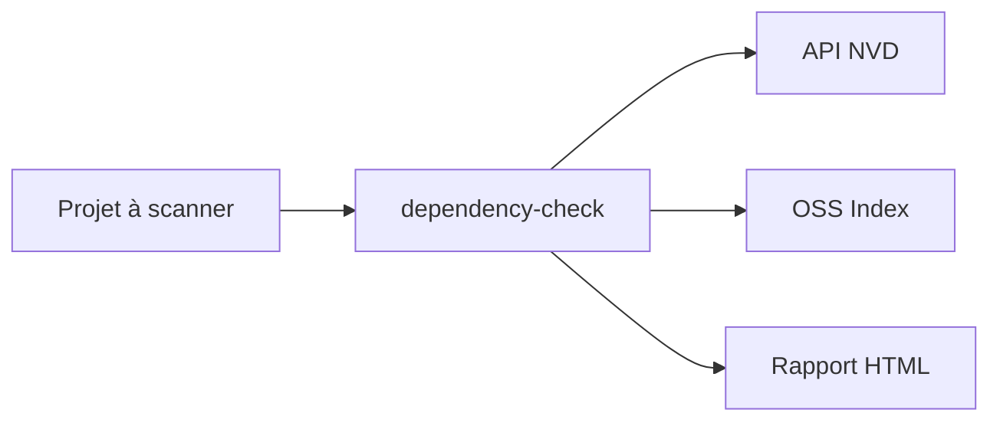

# dependency-check/DependencyCheck

> Software composition analysis that spots known vulnerabilities in a project's dependencies.

## The problem
Dependencies carry published flaws (CVEs) that nobody tracks by hand.

## What it actually does
It maps each dependency to a CPE identifier, queries the NVD database and produces a report linked to CVEs. It exists as a command line, Maven plugin, Gradle, Ant, Jenkins and Docker image. Depending on the stack, it calls npm, go, bundle-audit or dotnet.

## How it is wired
Simplified diagram based on the fiche, no diagram provided.


## Trying it
```bash
./bin/dependency-check.sh -h
./bin/dependency-check.sh --out . --scan [path to jar files to be scanned]
brew install dependency-check
```

## Cost and gotchas
Free, Java 11 minimum. An NVD API key is strongly recommended: without it, updates are extremely slow; in CI, rate limiting and caching are needed. The OSS Index analyzer requires Sonatype credentials.

## What it is not
It is not a code or secrets scanner: it only detects CVEs by CPE matching, with possible false positives. Upgrading to 12.1.0 or later is mandatory.

## Alternatives
No alternative named in the README.

## For you
Adopt to audit the dependencies of your images and MLOps pipelines, planning for the NVD key and a cache in CI.
