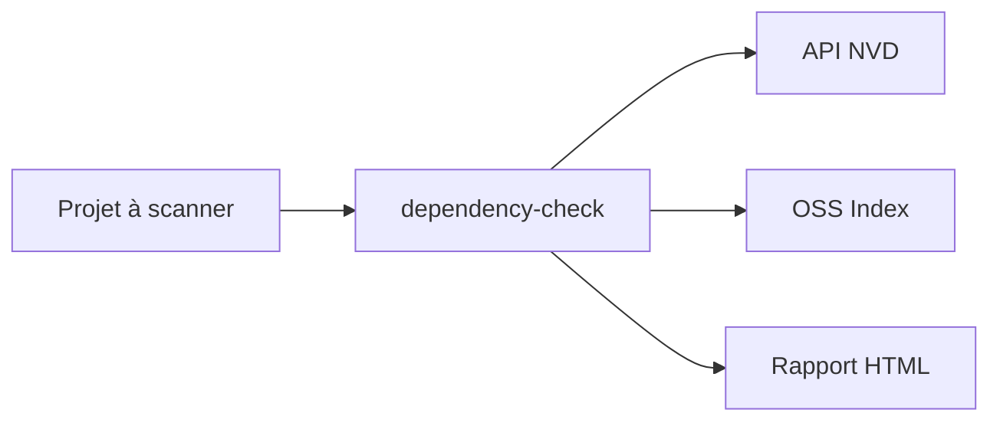

# dependency-check/DependencyCheck

> Analyse de composition logicielle qui repère les vulnérabilités connues dans les dépendances d'un projet.

## Le problème
Les dépendances embarquent des failles publiées (CVE) que personne ne suit à la main.

## Ce que ça fait vraiment
Il associe chaque dépendance à un identifiant CPE, interroge la base NVD et produit un rapport lié aux CVE. Il existe en ligne de commande, plugin Maven, Gradle, Ant, Jenkins et image Docker. Selon la pile, il appelle npm, go, bundle-audit ou dotnet.

## Comment c'est branché
Schéma simplifié d'après la fiche, sans diagramme fourni.


## Essayer
```bash
./bin/dependency-check.sh -h
./bin/dependency-check.sh --out . --scan [path to jar files to be scanned]
brew install dependency-check
```

## Coût et pièges
Gratuit, Java 11 minimum. Une clé d'API NVD est vivement recommandée : sans elle, les mises à jour sont extrêmement lentes ; en CI, limite de débit et cache nécessaires. L'analyseur OSS Index exige des identifiants Sonatype.

## Ce que ce n'est pas
Ce n'est pas un scanner de code ni de secrets : il détecte seulement des CVE par correspondance CPE, avec faux positifs possibles. Mise à niveau obligatoire vers 12.1.0 ou plus.

## Alternatives
Aucune alternative nommée dans le README.

## Pour toi
À adopter pour auditer les dépendances de tes images et pipelines MLOps, en prévoyant la clé NVD et un cache en CI.

