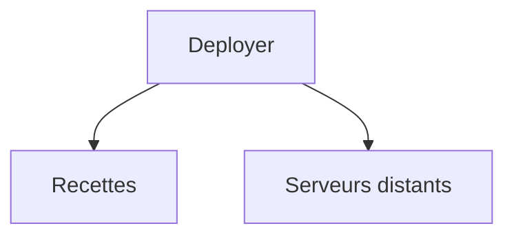

# deployphp/deployer

> Deployment tool in PHP with ready-made recipes for most frameworks.

## The problem
Deploying an application to a server by hand is repetitive and error-prone.

## What it actually does
The README provided is limited to three points: automatic server provisioning, zero-downtime deployments, per-framework recipes. The rest points to deployer.org.

## How it is wired
Not documented in the README provided.


## Trying it
No command in the README provided.
```bash
# non documenté dans le README fourni
```

## Cost and gotchas
Free, MIT. Prerequisite details not documented. Last push on 2026-08-26.

## What it is not
Not a container orchestrator. Minimal sheet: the README is too short to say more.

## Alternatives
None named in the README (a Docker image and a GitHub Action are mentioned).

## For you
Ignore: a PHP deployment tool, and too little material to judge its interest for MLOps.
