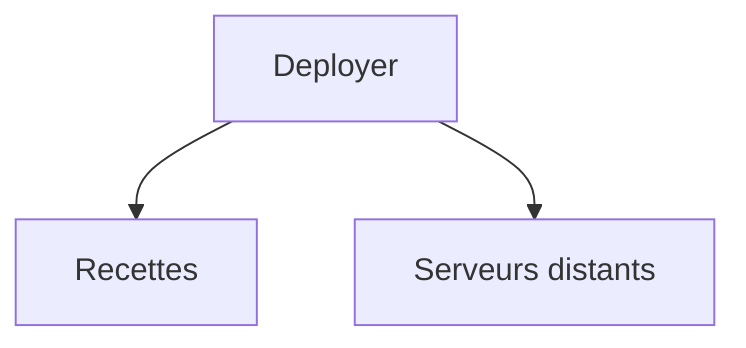

# deployphp/deployer

> Outil de déploiement en PHP avec recettes prêtes pour la plupart des frameworks.

## Le problème
Déployer une application sur un serveur à la main est répétitif et source d'erreurs.

## Ce que ça fait vraiment
Le README fourni se limite à trois points : provisionnement automatique de serveurs, déploiements sans interruption, recettes par framework. Le reste renvoie à deployer.org.

## Comment c'est branché
Non documenté dans le README fourni.


## Essayer
Aucune commande dans le README fourni.
```bash
# non documenté dans le README fourni
```

## Coût et pièges
Gratuit, MIT. Détails de prérequis non documentés. Dernier push le 2026-08-26.

## Ce que ce n'est pas
Pas un orchestrateur de conteneurs. Fiche minimale : le README est trop court pour en dire plus.

## Alternatives
Aucune nommée dans le README (une image Docker et une GitHub Action sont mentionnées).

## Pour toi
Ignorer : outil de déploiement PHP, et matière trop mince pour juger de son intérêt en MLOps.

