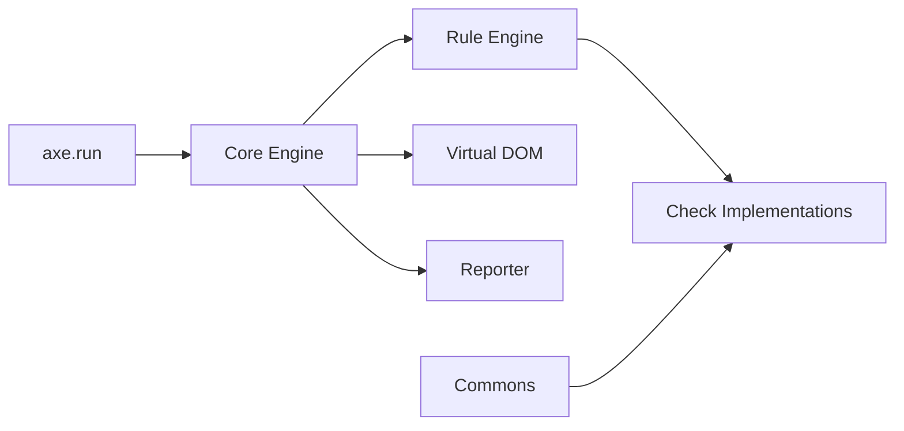

# dequelabs/axe-core

> Web accessibility (WCAG) testing engine to plug into your automated tests.

## The problem
Accessibility defects are caught late, by unreliable or poorly integrated tools.

## What it actually does
Runs WCAG 2.0/2.1/2.2 rules (A, AA, AAA) and best practices on a page; returns violations and "incomplete" elements to review. The README claims about 57% of WCAG issues are detected automatically. Localizable, configurable, handles iframes.

## How it is wired


## Trying it
```bash
npm install axe-core --save-dev
pnpm add --save-dev axe-core
```
```js
axe.run().then(results => {
  if (results.violations.length) throw new Error('Accessibility issues found');
});
```

## Cost and gotchas
Free; MPL-2.0 license (weak per-file copyleft). Deque trademarks are protected.

## What it is not
Does not replace a human audit: most issues escape automated detection.

## Alternatives
axe-linter (VS Code extension) and the axe extension, recommended by the README.

## For you
Ignore: useful for a web front end, outside the core of data/AI/MLOps.
