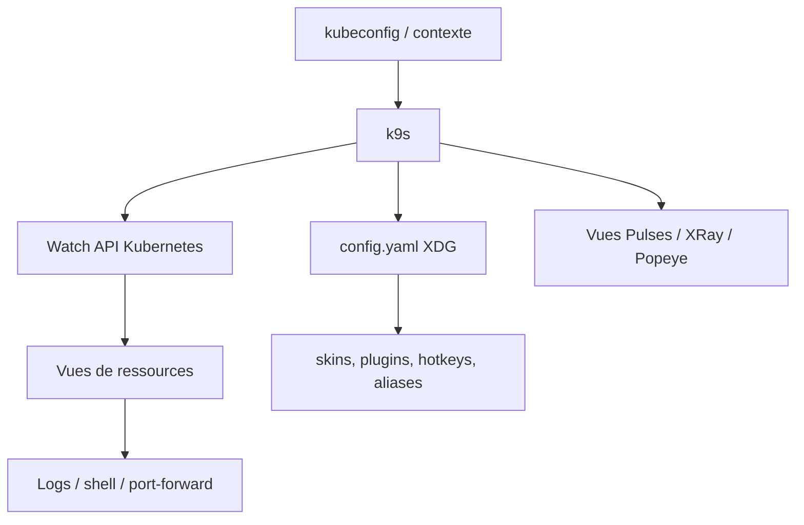

# derailed/k9s

> Terminal interface to navigate, observe and administer a Kubernetes cluster.

## The problem
`kubectl` forces you to retype the same command for every resource, every namespace, every context.
Following a pod that restarts in a loop takes three terminals and a lot of patience.

## What it actually does
Terminal interface that continuously watches cluster changes and offers the commands tied to the observed resource.
Navigation by alias (`:pod`, `:ctx`, `:ns`), regex and label filters, column sorting, multi-select, port-forward, shell into a container, logs and previous logs, editing and deletion.
Built-in views: Pulses, XRay, Popeye, service benchmarks, screendumps.
YAML configuration under XDG (`config.yaml`): refresh interval, API timeout, read-only mode, skins, plugins, hotkeys, aliases, custom views, GPU vendors.

## How it is wired


## Trying it
```shell
brew install derailed/k9s/k9s
k9s -n mycoolns
k9s --readonly
k9s info
docker run --rm -it -v ~/.kube/config:/root/.kube/config derailed/k9s
```

## Cost and gotchas
Free; the README reminds that the project relies on its maintainer and calls for sponsorship.
Terminal prerequisites: `TERM=xterm-256color`, `KUBE_EDITOR` set to edit; k9s prefers Kubernetes 1.28+.

## What it is not
It is not a deployment tool or GitOps: it observes and manipulates what already exists.
It is not a foundation-backed project: a single main maintainer, funded by donations.
The README itself shows a "still in flux, subject to change" note on the configuration; the provided README is truncated mid-way through the configuration section.

## Alternatives
- popeye — launched from k9s (`:popeye`), specialized in configuration auditing rather than navigation.

## For you
Install without hesitation as soon as you touch a cluster: immediate time savings, one hour of learning cost.
