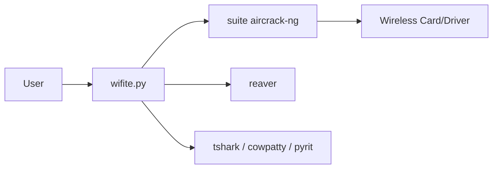

# derv82/wifite

> Historical Python 2 script orchestrating the aircrack-ng tools to audit Wi-Fi networks, replaced by Wifite2.

## The problem
Auditing the security of a wireless network requires chaining several separate programs from the aircrack-ng suite by hand.

## What it actually does
- A single file, `wifite.py`, launches airmon-ng, airodump-ng, aireplay-ng, packetforge-ng and aircrack-ng as subprocesses.
- It can also rely on reaver, pyrit, tshark and cowpatty if installed.
- It assumes Linux, root rights and a Wi-Fi card compatible with monitor mode and injection.
- The README states "life-support mode" and points to Wifite2.

## How it is wired


## Trying it
```bash
wget https://raw.github.com/derv82/wifite/master/wifite.py
chmod +x wifite.py
./wifite.py
```

## Cost and gotchas
Free, but Python 2.7 and root are required; the README advises against running a downloaded script as root and recommends a dedicated distribution or a VM with a USB dongle.

## What it is not
It is not the maintained version: 129 open issues, last push in 2022. Its use is lawful only on networks you are authorized to test. The catalog detects no license, while the README cites GPL v2.

## Alternatives
- Wifite2 (derv82/wifite2): successor cited by the README, more reliable and feature-rich.

## For you
Ignore: abandoned version, Python 2, outside the data/AI scope; prefer Wifite2 if an authorized Wi-Fi audit is needed.
