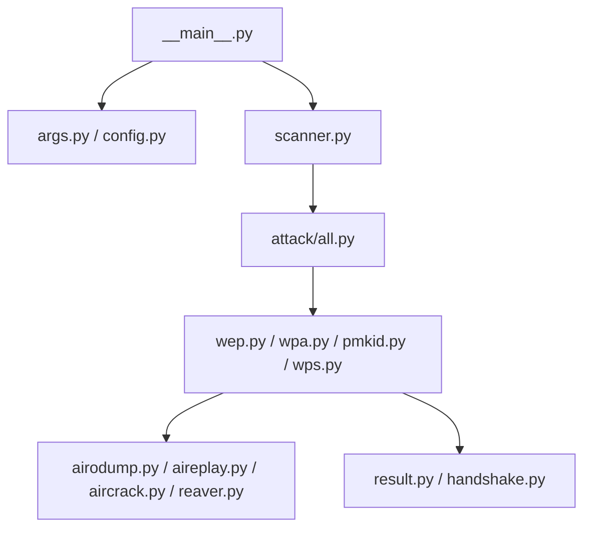

# derv82/wifite2

> Command-line Wi-Fi network auditing tool that orchestrates existing wireless utilities.

## The problem
A Wi-Fi security audit involves several separate tools to chain by hand.

## What it actually does
The README is reduced to a notice: a new version, **wifit3**, exists, with its own userspace drivers for USB adapters, on Linux and Windows. From the code, wifite2 scans access points, lets you pick targets, then delegates to per-protocol modules (WEP, WPA, PMKID, WPS) and can verify or process captures. Part of the code was not sampled: the rest is not documented here.

## How it is wired

## Trying it
No command documented in the README provided.

## Cost and gotchas
Free. Requires a compatible Wi-Fi adapter and the external tools installed. 351 open issues.

## What it is not
It is not a consumer tool: use it only on your own networks or with written authorization; otherwise the law forbids it in most countries. The README says the project's successor is wifit3.

## Alternatives
- wifit3: version indicated by the README, with its own USB drivers, Linux and Windows.

## For you
Ignore: outside the data / AI / MLOps scope, and the README itself points to a successor.
