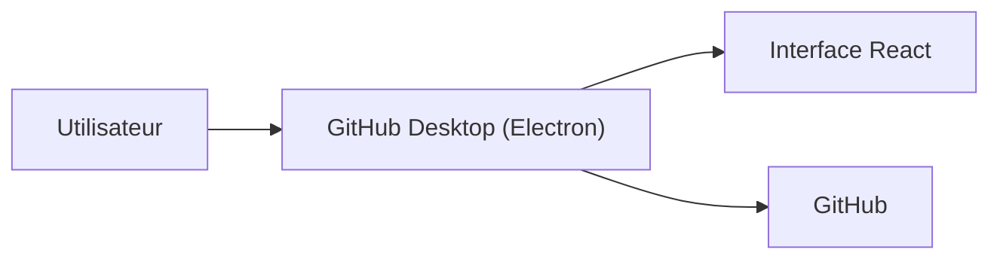

# desktop/desktop

> GitHub's desktop application built with Electron, TypeScript and React, for managing your repositories without the command line.

## The problem
Committing, branching and merging without mastering git in a terminal.

## What it actually does
A graphical client for GitHub: view changes, commit them (with attributed co-authors) and sync. Official macOS and Windows installers, beta channel, past versions. The code is an Electron application in TypeScript and React.

## How it is wired
Simplified diagram based on the sheet, no diagram provided.

## Trying it
No documented command: you download the installer for your system. To build, the README points to `setup.md`.

## Cost and gotchas
Free. Linux is not officially supported: only installers from a community fork. The maintainers warn that they lack time for individual issues.

## What it is not
Not a code review tool nor a full replacement for git on the CLI. Not officially available on Linux.

## Alternatives
No alternative named in the README.

## For you
Ignore: a graphical git client you almost certainly already have in the terminal or your editor, with no value of its own for a data or MLOps profile.
