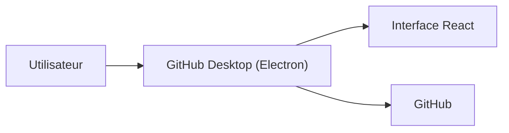

# desktop/desktop

> Application de bureau GitHub en Electron, TypeScript et React, pour gérer ses dépôts sans ligne de commande.

## Le problème
Commiter, brancher et fusionner sans maîtriser git en terminal.

## Ce que ça fait vraiment
Client graphique pour GitHub : voir les changements, les commiter (avec des co-auteurs attribués) et se synchroniser. Installeurs officiels macOS et Windows, canal bêta, versions passées. Le code est une application Electron en TypeScript et React.

## Comment c'est branché
Schéma simplifié d'après la fiche, sans diagramme fourni.

## Essayer
Aucune commande documentée : on télécharge l'installeur de son système. Pour compiler, le README renvoie à `setup.md`.

## Coût et pièges
Gratuit. Linux non supporté officiellement : seulement des installeurs d'un fork communautaire. Les mainteneurs préviennent qu'ils manquent de temps pour les problèmes individuels.

## Ce que ce n'est pas
Pas un outil de revue de code ni un remplaçant complet de git en CLI. Pas disponible officiellement sous Linux.

## Alternatives
Aucune alternative nommée dans le README.

## Pour toi
À ignorer : un client git graphique que tu as sûrement déjà en terminal ou dans ton éditeur, sans valeur propre pour un profil data ou MLOps.

