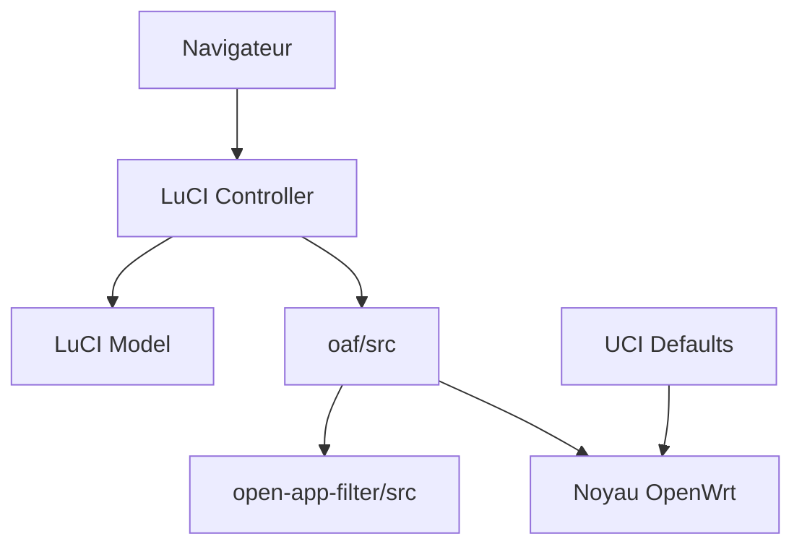

# destan19/OpenAppFilter

> Parental control for OpenWrt routers that identifies hundreds of applications through packet inspection.

## The problem
Blocking TikTok, YouTube or a game by DNS domain is easily bypassed; the application itself has to be recognized on the router.

## What it actually does
Identifies flows through layer-7 DPI, including the HTTPS domain, independently of DNS. Works per flow and targets modest hardware. Signatures can be customized. Installs as an OpenWrt plugin: a LuCI application, a service daemon and a kernel module.

## How it is wired
Diagram based on the code diagram.



## Trying it
```bash
git clone https://github.com/destan19/OpenAppFilter.git package/OpenAppFilter
echo "CONFIG_PACKAGE_luci-app-oaf=y" >>.config
make defconfig
make package/luci-app-oaf/compile V=s
make package/open-app-filter/compile V=s
make package/oaf/compile V=s
```

## Cost and gotchas
Free, but you need an already-built OpenWrt tree (or a prebuilt package from the releases page). Depends on the kernel version.

## What it is not
Not a full firewall nor a data analysis tool. Documentation and discussion group are mostly in Chinese or on Telegram.

## Alternatives
No alternative named in the README.

## For you
Ignore: only useful for a home OpenWrt router, outside the data/AI/MLOps scope.
