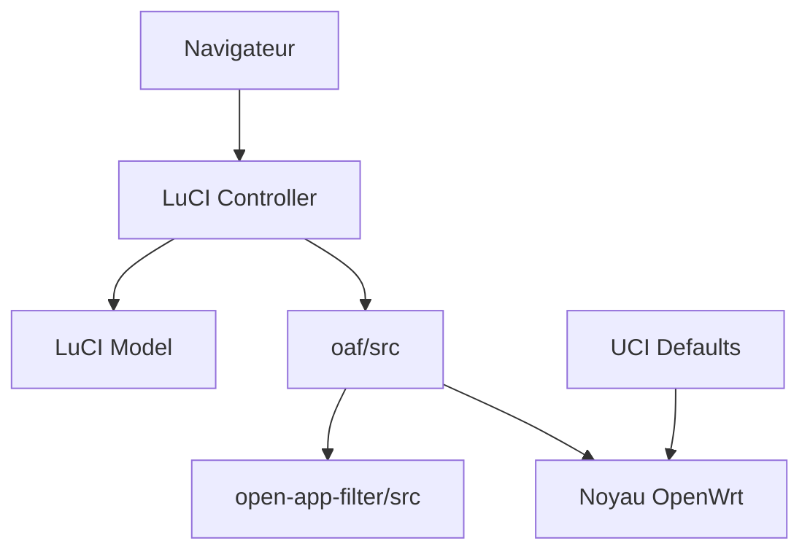

# destan19/OpenAppFilter

> Contrôle parental pour routeurs OpenWrt qui identifie des centaines d'applications par inspection de paquets.

## Le problème
Bloquer TikTok, YouTube ou un jeu par domaine DNS est contourné ; il faut reconnaître l'application elle-même sur le routeur.

## Ce que ça fait vraiment
Identifie les flux par DPI couche 7, y compris le domaine HTTPS, indépendamment du DNS. Fonctionne par flux et vise du matériel modeste. Signatures personnalisables. S'installe en plugin OpenWrt : application LuCI, démon de service et module noyau.

## Comment c'est branché
Schéma d'après le diagramme du code.



## Essayer
```bash
git clone https://github.com/destan19/OpenAppFilter.git package/OpenAppFilter
echo "CONFIG_PACKAGE_luci-app-oaf=y" >>.config
make defconfig
make package/luci-app-oaf/compile V=s
make package/open-app-filter/compile V=s
make package/oaf/compile V=s
```

## Coût et pièges
Gratuit, mais il faut une arborescence OpenWrt déjà compilée (ou un paquet précompilé de la page des releases). Dépend de la version noyau.

## Ce que ce n'est pas
Pas un pare-feu complet ni un outil d'analyse de données. Documentation et groupe de discussion surtout en chinois ou sur Telegram.

## Alternatives
Aucune alternative nommée dans le README.

## Pour toi
À ignorer : utile seulement pour un routeur OpenWrt domestique, hors périmètre data/IA/MLOps.

