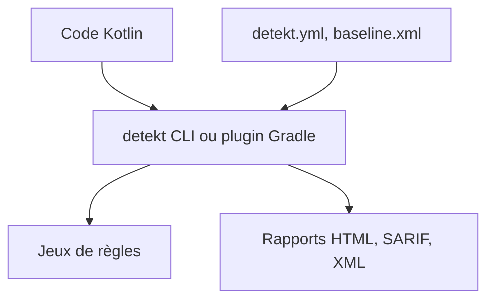

# detekt/detekt

> Static analysis tool for Kotlin code: code smell detection, configurable rules, reports.

## The problem
Without static analysis, bad practices and complexity pile up in a Kotlin project.

## What it actually does
Analyzes Kotlin code with configurable rule sets, baselines to ignore inherited issues, `@Suppress` for exceptions, and HTML, Markdown, SARIF and XML (Checkstyle) reports. Integrates with Gradle, and third-party extensions add rules. detekt 2.0 is announced as an alpha pre-release; 1.23.8 is the stable version.

## How it is wired
Simplified diagram based on the fiche, no diagram provided.



## Trying it
```bash
curl -sSLO https://github.com/detekt/detekt/releases/download/v[version]/detekt-cli-[version]-all.jar
java -jar detekt-cli-[version]-all.jar --help
```

## Cost and gotchas
Free. Real requirement: Java (JVM) and Gradle, missing from the prerequisites list. detekt 2.0 requires Gradle 8.14.3 or newer and remains in alpha.

## What it is not
Not a code formatter (the ktlint wrapper is an add-on) nor a security tool. It only checks Kotlin.

## Alternatives
- ktlint: cited as a source of ideas and provided via a wrapper.

## For you
Ignore unless you write Kotlin: outside the usual Python stack of a data / AI / MLOps profile.
