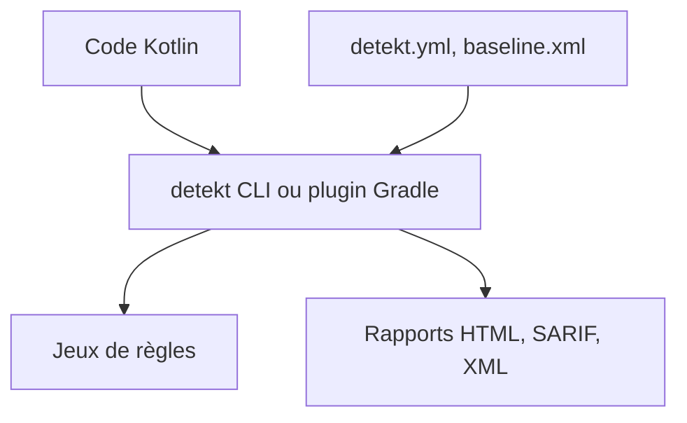

# detekt/detekt

> Outil d'analyse statique de code Kotlin : détection de code smells, règles configurables, rapports.

## Le problème
Sans analyse statique, les mauvaises pratiques et la complexité s'accumulent dans un projet Kotlin.

## Ce que ça fait vraiment
Analyse du code Kotlin avec des jeux de règles configurables, des baselines pour ignorer les problèmes hérités, `@Suppress` pour les exceptions, et des rapports HTML, Markdown, SARIF et XML (Checkstyle). S'intègre avec Gradle, et des extensions tierces ajoutent des règles. detekt 2.0 est annoncé en pré-version alpha ; la 1.23.8 est la version stable.

## Comment c'est branché
Schéma simplifié d'après la fiche, sans diagramme fourni.



## Essayer
```bash
curl -sSLO https://github.com/detekt/detekt/releases/download/v[version]/detekt-cli-[version]-all.jar
java -jar detekt-cli-[version]-all.jar --help
```

## Coût et pièges
Gratuit. Besoin réel : Java (JVM) et Gradle, absents de la liste des prérequis. detekt 2.0 impose Gradle 8.14.3 ou plus récent et reste en alpha.

## Ce que ce n'est pas
Pas un formateur de code (le wrapper ktlint est un ajout) ni un outil de sécurité. Il ne vérifie que du Kotlin.

## Alternatives
- ktlint : cité comme source d'idées et fourni via un wrapper.

## Pour toi
À ignorer sauf si tu écris du Kotlin : hors de la pile Python habituelle d'un profil data / IA / MLOps.

