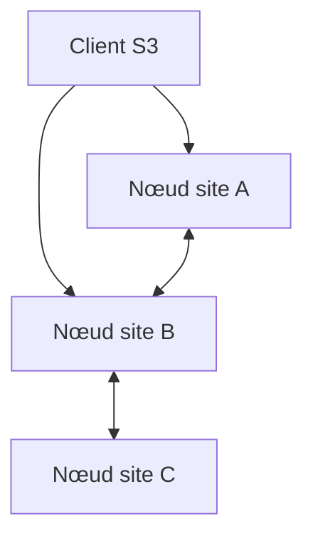

# deuxfleurs-org/garage

> S3-compatible distributed object storage, for self-hosting across several sites at small to medium scale.

## The problem
S3 storage replicated across remote sites is heavy to operate, and goes down when a server disappears.

## What it actually does
Garage provides an S3-compatible API on a cluster of nodes located in different places. Data is replicated across those places and the service stays available if some servers are unreachable. Lightweight and simple to operate, it has been used in production by Deuxfleurs since 2020. The README points to the documentation for details.

## How it is wired
Simplified diagram based on the sheet, no diagram provided.


## Trying it
```bash
# Aucune commande dans le README : voir les binaires publiés,
# le guide de démarrage rapide et la documentation du site.
```

## Cost and gotchas
Free, but several machines on distinct sites are needed to benefit from replication. AGPLv3 license.

## What it is not
Not a full equivalent of Amazon S3 at large scale: aimed at small to medium size. Not a POSIX file store.

## Alternatives
No alternative named in the README.

## For you
Adopt it to store datasets or model artifacts on self-hosted S3, simply and with replication.
