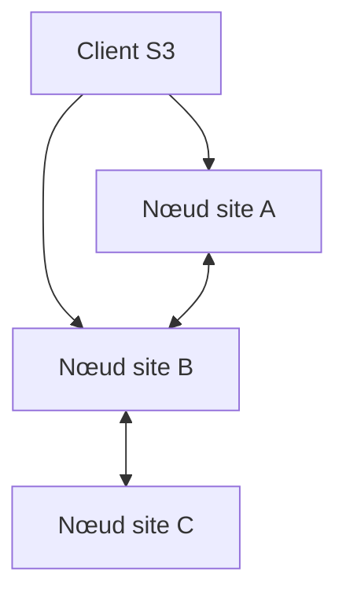

# deuxfleurs-org/garage

> Stockage d'objets distribué compatible S3, pour auto-héberger sur plusieurs sites à petite ou moyenne échelle.

## Le problème
Un stockage S3 répliqué entre sites distants est lourd à exploiter, et tombe en panne quand un serveur disparaît.

## Ce que ça fait vraiment
Garage fournit une API compatible S3 sur un cluster de nœuds situés en différents lieux. Les données sont répliquées entre ces lieux et le service reste disponible si certains serveurs sont injoignables. Léger et simple à opérer, il est utilisé en production par Deuxfleurs depuis 2020. Le README renvoie à la documentation pour le détail.

## Comment c'est branché
Schéma simplifié d'après la fiche, sans diagramme fourni.


## Essayer
```bash
# Aucune commande dans le README : voir les binaires publiés,
# le guide de démarrage rapide et la documentation du site.
```

## Coût et pièges
Gratuit, mais plusieurs machines sur des sites distincts sont nécessaires pour tirer parti de la réplication. Licence AGPLv3.

## Ce que ce n'est pas
Pas un équivalent complet d'Amazon S3 à grande échelle : visé petite à moyenne taille. Pas une base de fichiers POSIX.

## Alternatives
Aucune alternative nommée dans le README.

## Pour toi
À adopter pour stocker des jeux de données ou artefacts de modèles en S3 auto-hébergé, simplement et avec réplication.

