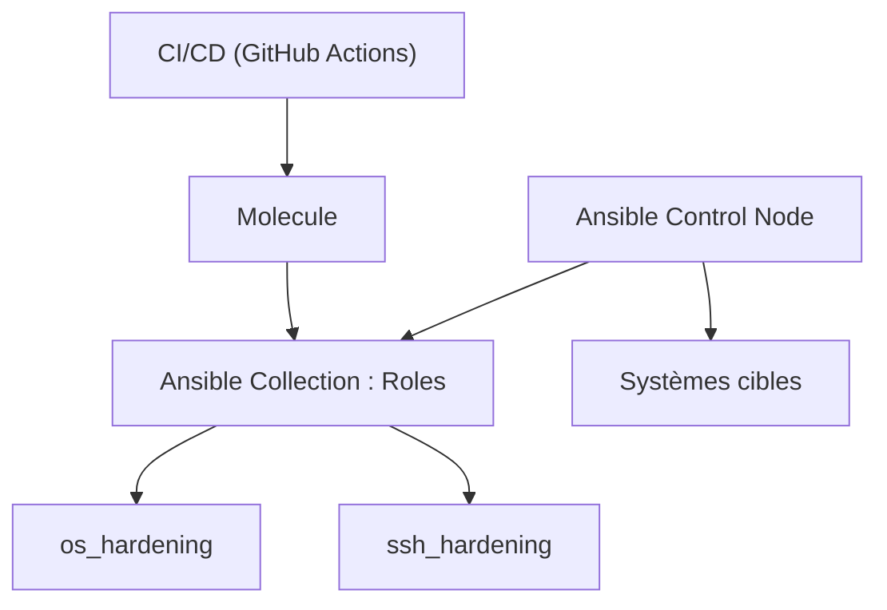

# dev-sec/ansible-collection-hardening

> Ansible collection for hardening Linux, MySQL, Nginx and OpenSSH, for administrators and security teams.

## The problem
Manually applying consistent security settings across several distributions and services is slow and prone to omissions.

## What it actually does
It provides the `os_hardening`, `mysql_hardening`, `nginx_hardening` and `ssh_hardening` roles, aligned with the Inspec DevSec Baselines. It covers CentOS Stream, AlmaLinux, Rocky, Debian, Ubuntu and partly Amazon Linux, Arch, Fedora and Suse. The apache and windows roles are work in progress and do not work. Ansible 2.16 or later is required.

## How it is wired


## Trying it
```bash
ansible-galaxy collection install devsec.hardening
```

## Cost and gotchas
Free. The roles modify real systems: test on a disposable environment before production. The standalone `os_hardening` role is abandoned (last version 6.2.0).

## What it is not
It is not a compliance audit: the Inspec tests live in a separate repository. Apache and Windows are not usable.

## Alternatives
No alternative named in the README.

## For you
Adopt it to harden the servers of an MLOps platform: roles tested with Molecule and Apache-2.0 license, to be replayed in a test environment first.
