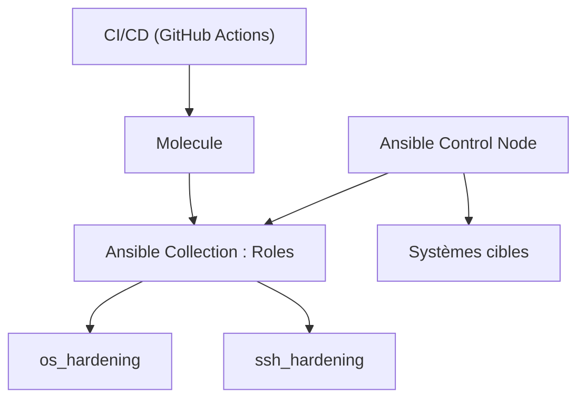

# dev-sec/ansible-collection-hardening

> Collection Ansible de durcissement de Linux, MySQL, Nginx et OpenSSH, pour administrateurs et équipes sécurité.

## Le problème
Appliquer à la main des réglages de sécurité cohérents sur plusieurs distributions et services est long et sujet aux oublis.

## Ce que ça fait vraiment
Elle fournit les rôles `os_hardening`, `mysql_hardening`, `nginx_hardening` et `ssh_hardening`, alignés sur les DevSec Baselines d'Inspec. Elle couvre CentOS Stream, AlmaLinux, Rocky, Debian, Ubuntu et en partie Amazon Linux, Arch, Fedora et Suse. Les rôles apache et windows sont en cours et ne fonctionnent pas. Ansible 2.16 ou plus est requis.

## Comment c'est branché


## Essayer
```bash
ansible-galaxy collection install devsec.hardening
```

## Coût et pièges
Gratuit. Les rôles modifient des systèmes réels : tester sur un environnement jetable avant la production. Le rôle `os_hardening` autonome est abandonné (dernière version 6.2.0).

## Ce que ce n'est pas
Ce n'est pas un audit de conformité : les tests Inspec sont un dépôt à part. Apache et Windows ne sont pas utilisables.

## Alternatives
Aucune alternative nommée dans le README.

## Pour toi
À adopter pour durcir les serveurs d'une plateforme MLOps : rôles testés avec Molecule et licence Apache-2.0, à rejouer d'abord en test.

