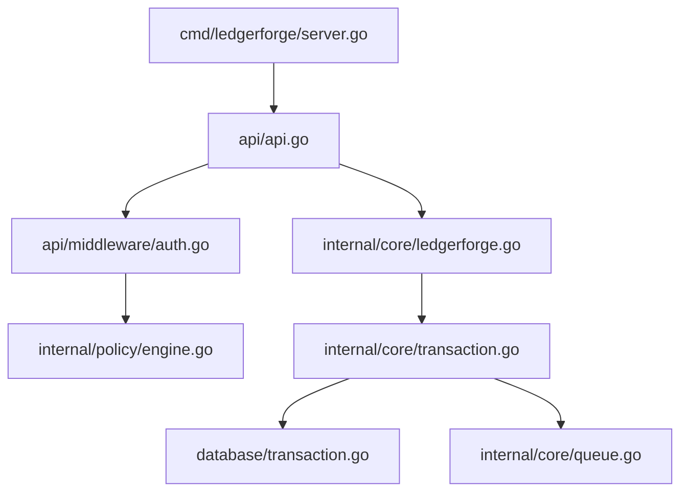

# devaccuracy/ledgerforge

> Double-entry accounting ledger with spending limits for AI agents, for fintech teams.

## The problem
Moving money through AI agents without server-side rules or a verifiable trail is risky.

## What it actually does
A double-entry ledger in integer units, accessible through an HTTP API, a Go library or an MCP server. Each API key carries limits (currencies, daily budgets, approvals), enforced server-side. An audit chain can be checked with `ledgerforge verify`. PostgreSQL stores the entries, Redis handles the queues. It does not connect payment rails.

## How it is wired


## Trying it
```bash
git clone https://github.com/devaccuracy/ledgerforge.git
cd ledgerforge
./examples/quickstart/start.sh
./examples/quickstart/transfer.sh
```

## Cost and gotchas
Free when self-hosted; Docker with Compose and Python 3 for the quickstart. PostgreSQL and Redis to operate, with updates and backups at your expense. A paid cloud offering exists alongside.

## What it is not
Not a payment gateway or a ready-made accounting model: those points are left to your application. The quickstart is local only.

## Alternatives
None cited in the README.

## For you
Worth watching: agent limits enforced server-side are a good guardrail model, but the project is recent (May 2026) and outside your direct scope.
