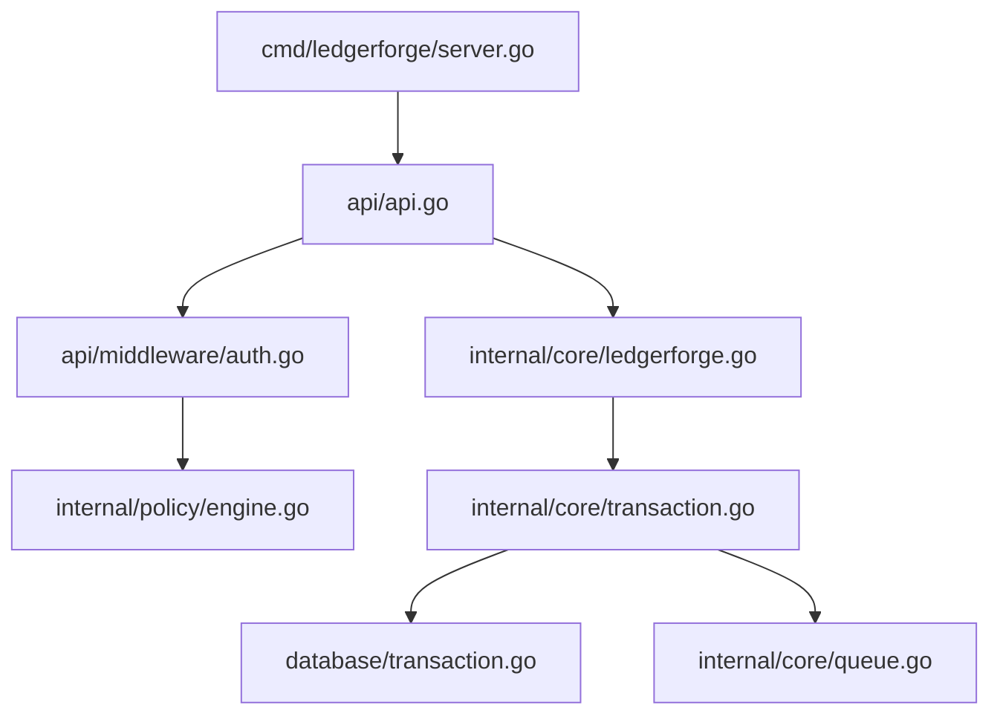

# devaccuracy/ledgerforge

> Registre comptable en partie double, avec plafonds de dépense pour agents IA, pour équipes fintech.

## Le problème
Faire circuler de l'argent via des agents IA sans règle serveur ni trace vérifiable est risqué.

## Ce que ça fait vraiment
Registre en partie double en unités entières, accessible par API HTTP, bibliothèque Go ou serveur MCP. Chaque clé d'API porte des limites (devises, budgets quotidiens, validations), appliquées côté serveur. Une chaîne d'audit se vérifie avec `ledgerforge verify`. PostgreSQL stocke les écritures, Redis gère les files. Il ne connecte pas les circuits de paiement.

## Comment c'est branché


## Essayer
```bash
git clone https://github.com/devaccuracy/ledgerforge.git
cd ledgerforge
./examples/quickstart/start.sh
./examples/quickstart/transfer.sh
```

## Coût et pièges
Gratuit en auto-hébergement ; Docker avec Compose et Python 3 pour le quickstart. PostgreSQL et Redis à exploiter, mises à jour et sauvegardes à ta charge. Une offre cloud payante existe à côté.

## Ce que ce n'est pas
Pas une passerelle de paiement ni un modèle comptable prêt à l'emploi : ces points restent à ton application. Le quickstart est local uniquement.

## Alternatives
Aucune citée dans le README.

## Pour toi
À surveiller : les plafonds d'agents appliqués côté serveur sont un bon modèle de garde-fou, mais le projet est récent (mai 2026) et hors de ton périmètre direct.

