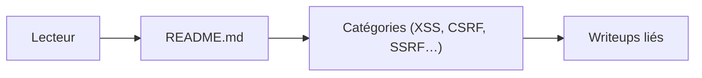

# devanshbatham/Awesome-Bugbounty-Writeups

> List of bug-hunting write-ups sorted by vulnerability type, for web security learners.

## The problem
Bug bounty experience reports are scattered across blogs.

## What it actually does
A README that lists articles by category: XSS (the largest), CSRF, clickjacking, LFI, subdomain takeover, DoS, authentication bypass, SQL injection, IDOR, 2FA, CORS, SSRF, race conditions, code execution, buffer overflow, Android. Nothing is executed: the code is only a self-update TODO.

## How it is wired

## Trying it
Nothing to install: read the README on GitHub.

## Cost and gotchas
Free. The last push dates from August 2023: some links are probably dead. No license declared.

## What it is not
Not a structured course or a tool: article titles, often without a summary.

## Alternatives
None named in the README.

## For you
Ignore: offensive web security, unrelated to your field, and old.
