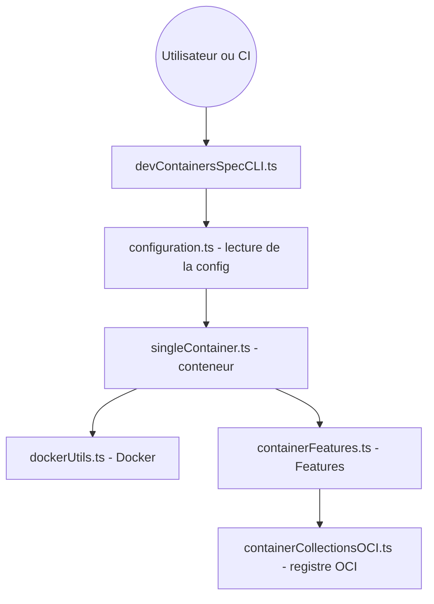

# devcontainers/cli

> CLI that creates and configures a development container from a devcontainer.json file, locally or in CI.

## The problem
A project's dependencies, runtimes and tools differ from one machine to another; reproducing the same development and test environment costs time.

## What it actually does
The command reads `devcontainer.json`, builds the image, starts the container, applies the Features, runs the lifecycle commands (`postCreateCommand`) and launches commands inside it via `exec`. It generates a lockfile to pin Feature versions, and provides tools to test Features and Templates. `stop` and `down` are not done yet.

## How it is wired


## Trying it
```bash
npm install -g @devcontainers/cli
git clone https://github.com/microsoft/vscode-remote-try-rust
devcontainer up --workspace-folder <path-to-vscode-remote-try-rust>
devcontainer exec --workspace-folder <path-to-vscode-remote-try-rust> cargo run
```
Alternative without Node: `curl -fsSL https://raw.githubusercontent.com/devcontainers/cli/main/scripts/install.sh | sh`.

## Cost and gotchas
Free. Docker is required. The npm install requires Python and a C/C++ compiler. 332 open issues. The README states that the CLI is under active development.

## What it is not
It is not a production multi-container orchestrator: it targets a single container, with no orchestration. It includes no editor; IDE extensions live elsewhere.

## Alternatives
No alternative named in the README.

## For you
Adopt: give your team and your CI the same reproducible environment for Python or ML projects, without rewriting a Dockerfile for each tool.
