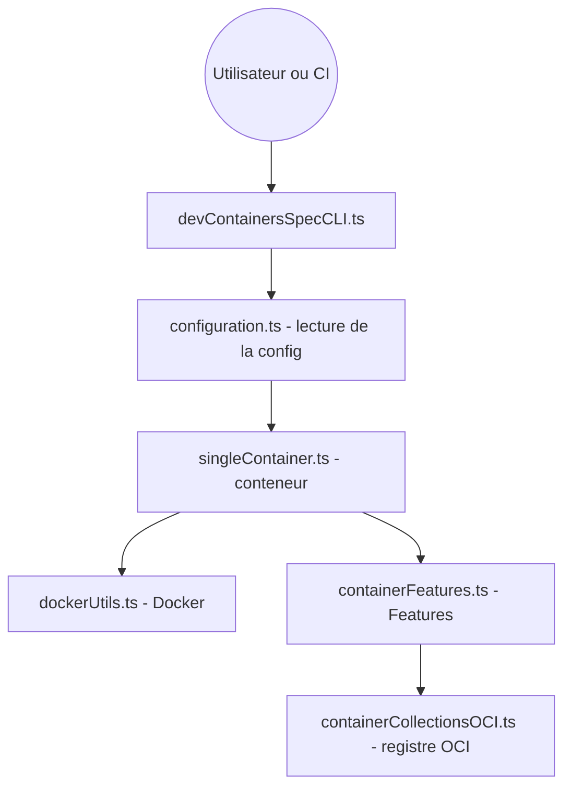

# devcontainers/cli

> CLI qui crée et configure un conteneur de développement à partir d'un fichier devcontainer.json, en local ou en CI.

## Le problème
Les dépendances, runtimes et outils d'un projet diffèrent d'une machine à l'autre ; reproduire le même environnement de développement et de test coûte du temps.

## Ce que ça fait vraiment
La commande lit `devcontainer.json`, construit l'image, démarre le conteneur, applique les Features, exécute les commandes de cycle de vie (`postCreateCommand`) et lance des commandes dedans via `exec`. Elle génère un lockfile pour figer les versions de Features, et fournit des outils pour tester Features et Templates. `stop` et `down` ne sont pas encore faits.

## Comment c'est branché


## Essayer
```bash
npm install -g @devcontainers/cli
git clone https://github.com/microsoft/vscode-remote-try-rust
devcontainer up --workspace-folder <path-to-vscode-remote-try-rust>
devcontainer exec --workspace-folder <path-to-vscode-remote-try-rust> cargo run
```
Alternative sans Node : `curl -fsSL https://raw.githubusercontent.com/devcontainers/cli/main/scripts/install.sh | sh`.

## Coût et pièges
Gratuit. Docker obligatoire. L'installation npm demande Python et un compilateur C/C++. 332 issues ouvertes. Le README précise que la CLI est en développement actif.

## Ce que ce n'est pas
Ce n'est pas un orchestrateur multi-conteneurs de production : il cible un conteneur unique, sans orchestration. Il n'inclut pas d'éditeur ; les extensions d'IDE sont ailleurs.

## Alternatives
Aucune alternative nommée dans le README.

## Pour toi
À adopter : donne le même environnement reproductible à ton équipe et à ta CI pour des projets Python ou ML, sans réécrire de Dockerfile par outil.

