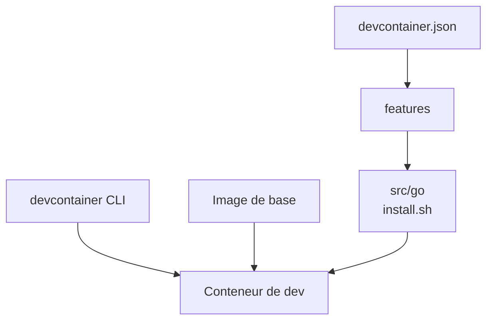

# devcontainers/features

> Collection of reusable installation building blocks for adding a language or tool to a development container.

## The problem
There is always a language or CLI missing from the base image of a development container, and everyone rewrites their own install scripts.

## What it actually does
Each "Feature" is a folder under `src` with a `devcontainer-feature.json` and an `install.sh`. You declare it in the `features` property of `devcontainer.json`, with a version that can be pinned using semantic versioning (`:1`, `:1.0`, `:1.0.0`). Each Feature has a `test` folder with `test.sh`, run in CI by the devcontainer CLI.

## How it is wired
Simplified diagram based on the sheet, no diagram provided.


## Trying it
```bash
git clone <my-project-with-devcontainer>
devcontainer build --workspace-folder <path-to-my-project-with-devcontainer>
```
Reference in the JSON: `"ghcr.io/devcontainers/features/go:1"`.

## Cost and gotchas
Free. You need a tool compatible with the dev container specification and a generic Debian image. More than 300 open issues.

## What it is not
It is not a standalone tool: without a compatible CLI or editor, nothing runs. It is not a container orchestrator.

## Alternatives
No alternative named in the README.

## For you
Adopt it to reproduce a Python/CUDA/tools environment in a dev container; low risk, a standard backed by Microsoft.
