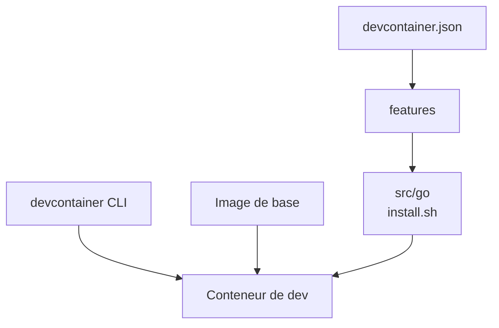

# devcontainers/features

> Collection de briques d'installation réutilisables pour ajouter un langage ou un outil à un conteneur de développement.

## Le problème
Il manque toujours un langage ou un CLI dans l'image de base d'un conteneur de développement, et chacun réécrit ses scripts d'installation.

## Ce que ça fait vraiment
Chaque « Feature » est un dossier de `src` avec un `devcontainer-feature.json` et un `install.sh`. Tu la déclares dans la propriété `features` de `devcontainer.json`, avec version épinglable en suivi sémantique (`:1`, `:1.0`, `:1.0.0`). Chaque Feature a un dossier `test` avec `test.sh`, exécuté en CI par la CLI devcontainer.

## Comment c'est branché
Schéma simplifié d'après la fiche, sans diagramme fourni.


## Essayer
```bash
git clone <my-project-with-devcontainer>
devcontainer build --workspace-folder <path-to-my-project-with-devcontainer>
```
Référence dans le JSON : `"ghcr.io/devcontainers/features/go:1"`.

## Coût et pièges
Gratuit. Il faut un outil compatible avec la spécification dev container et une image Debian générique. Plus de 300 issues ouvertes.

## Ce que ce n'est pas
Ce n'est pas un outil autonome : sans CLI ou éditeur compatible, rien ne s'exécute. Ce n'est pas un orchestrateur de conteneurs.

## Alternatives
Aucune alternative nommée dans le README.

## Pour toi
À adopter pour reproduire un environnement Python/CUDA/outils dans un conteneur de dev ; peu de risque, standard soutenu par Microsoft.

