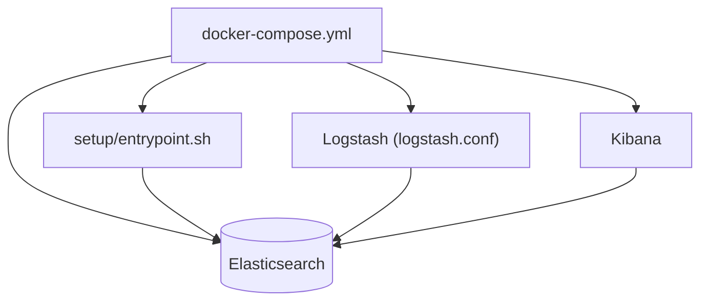

# deviantony/docker-elk

> Docker Compose template to run Elasticsearch, Logstash and Kibana locally in order to explore your data.

## The problem
Installing and connecting the Elastic stack by hand takes time, especially for a simple exploration.

## What it actually does
A Compose file starts Elasticsearch, Logstash and Kibana from the official images. A `setup` container creates the users and roles. Optional extensions add Filebeat, Metricbeat, Heartbeat, Fleet and Curator. A `tls` variant enables encryption. Platinum features are active during a 30-day trial.

## How it is wired


## Trying it
```bash
git clone https://github.com/deviantony/docker-elk.git
docker compose up setup
docker compose up
cat /path/to/logfile.log | nc -q0 localhost 50000
```

## Cost and gotchas
Free, 1.5 GB of RAM minimum. The default password `changeme` must be changed. After 30 days, the paid features fall back to the Basic license. Elasticsearch's startup checks are disabled.

## What it is not
Not a production deployment: the README says so clearly. The configuration is not hot-reloaded. The project follows major version 9.x.

## Alternatives
No alternative named in the README.

## For you
To adopt for a local test bench of logs or search: documented, simple and maintained, provided you do not put it into production as is.
