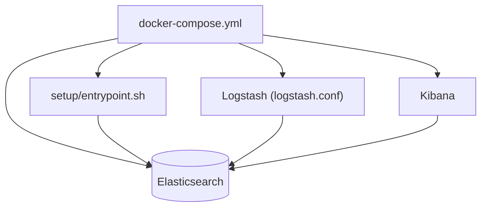

# deviantony/docker-elk

> Modèle Docker Compose pour lancer Elasticsearch, Logstash et Kibana en local afin d'explorer ses données.

## Le problème
Installer et relier la pile Elastic à la main prend du temps, surtout pour une simple exploration.

## Ce que ça fait vraiment
Un Compose démarre Elasticsearch, Logstash et Kibana depuis les images officielles. Un conteneur `setup` crée les utilisateurs et rôles. Des extensions optionnelles ajoutent Filebeat, Metricbeat, Heartbeat, Fleet et Curator. Une variante `tls` active le chiffrement. Les fonctions Platinum sont actives 30 jours d'essai.

## Comment c'est branché


## Essayer
```bash
git clone https://github.com/deviantony/docker-elk.git
docker compose up setup
docker compose up
cat /path/to/logfile.log | nc -q0 localhost 50000
```

## Coût et pièges
Gratuit, 1,5 Go de RAM minimum. Le mot de passe par défaut `changeme` est à changer. Après 30 jours, les fonctions payantes basculent sur la licence Basic. Les vérifications de démarrage d'Elasticsearch sont désactivées.

## Ce que ce n'est pas
Pas un déploiement de production : le README le dit clairement. La configuration n'est pas rechargée à chaud. Le projet suit la version majeure 9.x.

## Alternatives
Aucune alternative nommée dans le README.

## Pour toi
À adopter pour un banc d'essai local de logs ou de recherche : documenté, simple et maintenu, à condition de ne pas le passer en production tel quel.

