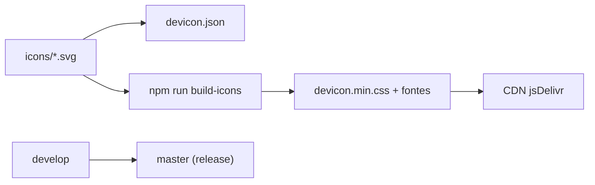

# devicons/devicon

> Collection of language and tool logos, as an icon font and SVG, for websites and documentation.

## The problem
Getting consistent technical logos (original, plain, with or without name, colored or not) without hunting for them one by one.

## What it actually does
Provides more than 150 icons as SVG and as a font (`devicon.min.css`), usable via CSS class (`devicon-devicon-plain`), inline SVG or `` through jsDelivr. `devicon.json` references the icons. The repository separates `develop` (raw SVGs, unbuilt icons) and `master` (official versions). Icons are built with `npm run build-icons` and `npm run build-css`.

## How it is wired


## Trying it
```bash
npm install --save devicon
npm install          # pour construire soi-même
npm run build-icons
npm run build-css
npm run dev          # port 8000
```

## Cost and gotchas
Free. Building the icons requires Firefox, Python 3.8 and npm. Brands remain the property of their owners: respect their guidelines.

## What it is not
Not a permission to use the logos: the README reminds that they do not imply endorsement and that each brand's rules must be followed.

## Alternatives
None cited in the README.

## For you
Ignore: useful for a web page or a README, but of no value in itself for data/AI/MLOps work.
