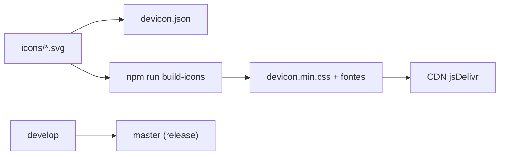

# devicons/devicon

> Collection de logos de langages et d'outils, en police d'icônes et SVG, pour sites et documentations.

## Le problème
Obtenir des logos techniques cohérents (originaux, plains, avec ou sans nom, colorés ou non) sans les chercher un par un.

## Ce que ça fait vraiment
Fournit plus de 150 icônes en SVG et en police (`devicon.min.css`), utilisables par classe CSS (`devicon-devicon-plain`), SVG intégré ou `` via jsDelivr. `devicon.json` référence les icônes. Le dépôt sépare `develop` (SVG bruts, icônes non construites) et `master` (versions officielles). Les icônes se construisent avec `npm run build-icons` et `npm run build-css`.

## Comment c'est branché


## Essayer
```bash
npm install --save devicon
npm install          # pour construire soi-même
npm run build-icons
npm run build-css
npm run dev          # port 8000
```

## Coût et pièges
Gratuit. Construire les icônes exige Firefox, Python 3.8 et npm. Les marques restent la propriété de leurs détenteurs : respecter leur charte.

## Ce que ce n'est pas
Pas une autorisation d'usage des logos : le README rappelle qu'ils ne valent pas approbation et qu'il faut suivre les règles de chaque marque.

## Alternatives
Aucune citée dans le README.

## Pour toi
Ignorer : utile pour une page web ou un README, mais sans valeur pour un travail data/IA/MLOps en soi.

