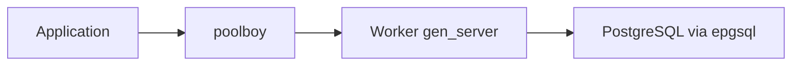

# devinus/poolboy

> Bibliothèque de pool de workers pour Erlang, pour contrôler le nombre de processus ou connexions ouverts.

## Le problème
Ouvrir une connexion base de données par requête sature le serveur ; il faut un pool borné.

## Ce que ça fait vraiment
- Emprunte (`checkout`) et rend (`checkin`) un worker, ou `transaction` pour le faire automatiquement.
- Options : nom, module worker, taille maximale, dépassement autorisé (`max_overflow`), stratégie `lifo` ou `fifo`.
- Le README montre un pool de connexions PostgreSQL avec epgsql.

## Comment c'est branché


## Essayer
```erlang
1> Worker = poolboy:checkout(PoolName).
2> gen_server:call(Worker, Request).
3> poolboy:checkin(PoolName, Worker).
```

## Coût et pièges
Gratuit. Dernier push en avril 2023. Trois auteurs cités, pas de maintenance claire.

## Ce que ce n'est pas
Pas un pool pour d'autres langages. Pas de métriques intégrées.

## Alternatives
Aucune alternative nommée dans le README.

## Pour toi
À ignorer : Erlang et peu maintenu, sans lien avec data / IA.

