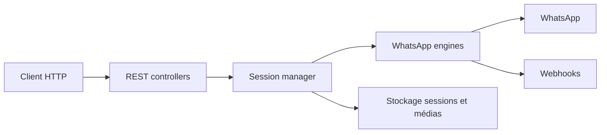

# devlikeapro/waha

> Self-hosted WhatsApp HTTP API in Docker, for sending messages over REST.

## The problem
Automating WhatsApp messages requires handling sessions, QR codes and a connection engine.

## What it actually does
A container exposes a REST API (Swagger included): you create a session, scan a QR code, then send messages. The code describes several engines, webhooks, WebSocket, Chatwoot integration, MCP tools, Prometheus metrics and a dashboard. The WAHA Plus version is separate (private image, requires credentials).

## How it is wired


## Trying it
```bash
docker pull devlikeapro/waha
docker run -it --rm -p 3000:3000/tcp --name waha devlikeapro/waha
curl -d "{\"chatId\": \"${PHONE}@c.us\", \"text\": \"Hello from WhatsApp HTTP API\" }" -H "Content-Type: application/json" -X POST http://localhost:3000/api/sendText
```

## Cost and gotchas
Free for the base version; multi-session is in Plus (paid). A phone with WhatsApp is required for the QR code.

## What it is not
Not the official WhatsApp Business API: risk of account ban, not documented in the README.

## Alternatives
No alternative named in the README.

## For you
Keep an eye on it: a practical building block to connect an agent or an LLM to WhatsApp, with a compliance risk to assess.
