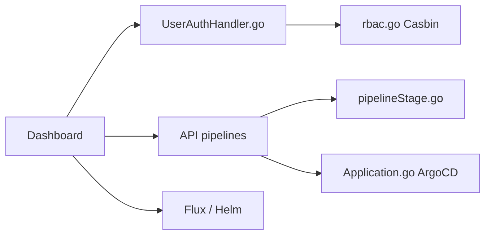

# devtron-labs/devtron

> Kubernetes CI/CD dashboard and platform that unifies Helm, ArgoCD and FluxCD across several clusters.

## The problem
Managing Helm and GitOps applications across several clusters requires juggling between tools and access rights.

## What it actually does
The dashboard manages Helm applications with rollback, explores resources (nodes, pods, CRDs), compares configuration drift and enforces SSO and RBAC (Dex, Casbin). Platform mode adds no-code CI/CD pipelines, ArgoCD, Trivy or Clair scanning, notifications, Grafana and deployment metrics. NATS links the microservices.

## How it is wired


## Trying it
```bash
helm repo add devtron https://helm.devtron.ai
helm install devtron devtron/devtron-operator \
--create-namespace --namespace devtroncd
kubectl -n devtroncd get secret devtron-secret -o jsonpath='{.data.ADMIN_PASSWORD}' | base64 -d
```

## Cost and gotchas
Free; you need a Kubernetes cluster and Helm. 770 open issues. The full installation enables several components (Argo CD, Trivy, Grafana).

## What it is not
Not ML-specific: it is a general delivery platform. Vulnerability scanning only covers the image build time.

## Alternatives
- ArgoCD and FluxCD: integrated rather than replaced.

## For you
Worth watching: relevant if your MLOps team manages a shared cluster; superfluous if you already deploy with ArgoCD alone.
