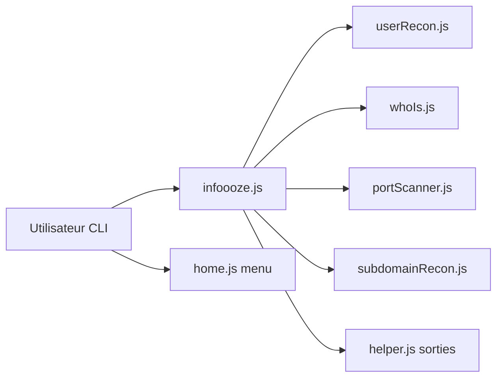

# devxprite/infoooze

> Node.js command-line OSINT reconnaissance tool: Whois, IP, DNS, subdomains, ports.

## The problem
Gathering public information about a domain, an IP or a user means chaining many tools.

## What it actually does
A single CLI bundles about ten modules: username search, email, Instagram, GitHub, Whois, IP, DNS, headers, domain age, subdomains, port scan, EXIF, YouTube, URL. Interactive menu or options, results can be saved to a text file.

## How it is wired


## Trying it
```bash
sudo npm install infoooze -g -s
infoooze -w google.com
infoooze -s google.com
infoooze -p 8.8.8.8
```

## Cost and gotchas
Free. Last push in October 2023. It queries external services whose status is not guaranteed. Port scanning unauthorized targets is illegal.

## What it is not
Not a complete security suite. The README's capabilities exceed what the sampled code shows.

## Alternatives
No alternative cited in the README.

## For you
Ignore: OSINT is outside the data/AI scope, and the project has been inactive since 2023.
