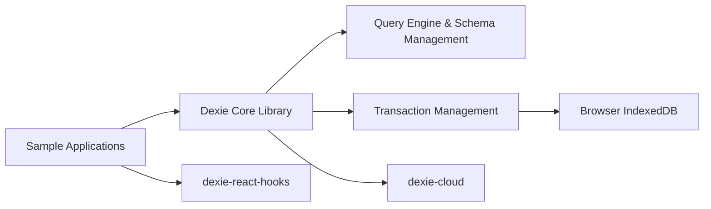

# dexie/Dexie.js

> JavaScript wrapper around IndexedDB for storing and querying data in the browser.

## The problem
The native IndexedDB API is verbose, buggy across browsers, and painful for queries.

## What it actually does
Versioned schema declaration, chained queries (`where().below()`), bulk operations.
Works around IndexedDB implementation bugs.
React hooks (`useLiveQuery`) and tutorials for Svelte, Vue, Angular.
Dexie Cloud add-on: real-time sync, auth, access control, offline-first.

## How it is wired


## Trying it
```bash
npm install dexie
npm install dexie-cloud-addon
pnpm install
pnpm run build
```

## Cost and gotchas
The library is free; Dexie Cloud is a service (hosted or self-hosted).

## What it is not
Not a server database. `dexie-observable` and `dexie-syncable` are deprecated, do not use them.

## Alternatives
No alternative named in the README.

## For you
Ignore on the data/ML side: browser storage for web apps, outside your scope except for an offline front-end demo.
