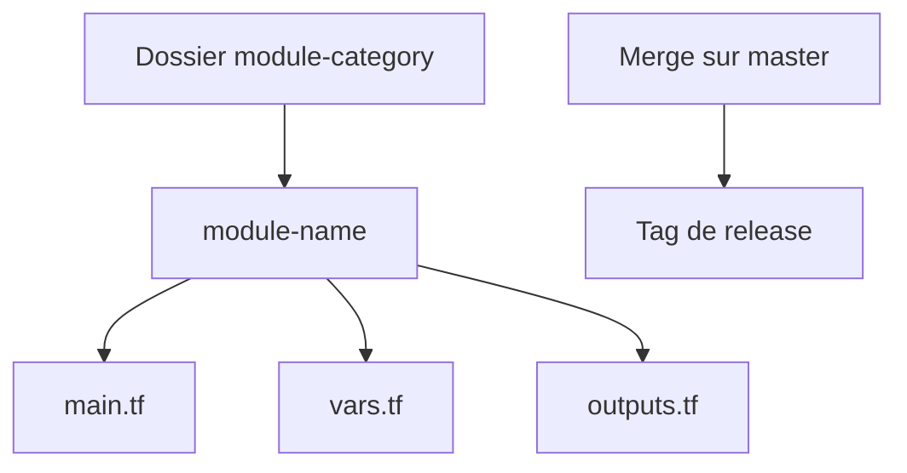

# dfds/infrastructure-modules

> Terraform modules for DFDS's AWS infrastructure, with structure conventions and a versioning process.

## The problem
A team that maintains many Terraform modules needs a shared structure and controlled versions.

## What it actually does
A collection of AWS modules organized by category (`module-category/module-name` with `main.tf`, `outputs.tf`, `vars.tf`). The README describes best practices, a command to find a compatible EKS AMI, automatic release tags driven by labels, and optional pre-commit hooks.

## How it is wired
Simplified diagram based on the sheet, no diagram provided.


## Trying it
```bash
aws ssm get-parameter --name /aws/service/eks/optimized-ami/$EKS_CLUSTER_VERSION/amazon-linux-2023/x86_64/standard/recommended/image_id --region $AWS_REGION --query "Parameter.Value" --output text
pre-commit install
```

## Cost and gotchas
AWS account required. No branch protection: security relies on release tags. The list of modules is not in the README.

## What it is not
Not a generic library reusable as is: it is a company's internal infrastructure, published in the open.

## Alternatives
No alternative named in the README.

## For you
Ignore: internal modules with no direct link to data; only the organization conventions might inspire you.
