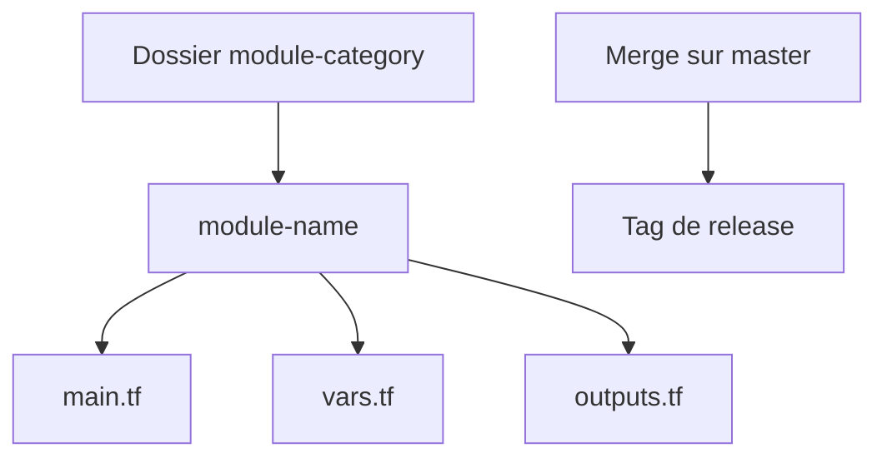

# dfds/infrastructure-modules

> Modules Terraform pour l'infrastructure AWS de DFDS, avec conventions de structure et processus de version.

## Le problème
Une équipe qui maintient beaucoup de modules Terraform a besoin d'une structure commune et de versions maîtrisées.

## Ce que ça fait vraiment
Collection de modules AWS rangés par catégorie (`module-category/module-name` avec `main.tf`, `outputs.tf`, `vars.tf`). Le README décrit les bonnes pratiques, une commande pour retrouver une AMI EKS compatible, des tags de release automatiques selon des labels, et des hooks pre-commit optionnels.

## Comment c'est branché
Schéma simplifié d'après la fiche, sans diagramme fourni.


## Essayer
```bash
aws ssm get-parameter --name /aws/service/eks/optimized-ami/$EKS_CLUSTER_VERSION/amazon-linux-2023/x86_64/standard/recommended/image_id --region $AWS_REGION --query "Parameter.Value" --output text
pre-commit install
```

## Coût et pièges
Compte AWS requis. Pas de protection de branche : la sécurité repose sur les tags de release. La liste des modules n'est pas dans le README.

## Ce que ce n'est pas
Pas une bibliothèque générique réutilisable telle quelle : c'est l'infra interne d'une société, publiée en clair.

## Alternatives
Aucune alternative nommée dans le README.

## Pour toi
À ignorer : modules internes sans rapport direct avec la data ; seules les conventions d'organisation peuvent inspirer.

