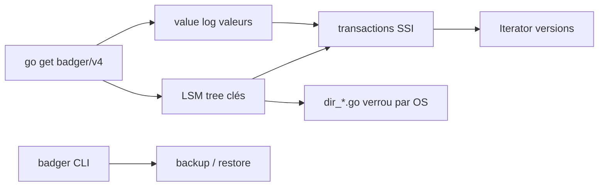

# dgraph-io/badger

> Embedded pure-Go key-value database, designed for SSDs.

## The problem
Fast key-value stores go through C (RocksDB): cgo, painful cross-compilation, and high write amplification on SSDs.

## What it actually does
Implements the idea from the WiscKey paper: separate keys from values, with an LSM tree for keys and a separate value log, which greatly reduces write amplification compared with a classic LSM. Concurrent ACID transactions with serializable snapshot isolation (SSI). Sorted access, snapshots, TTL, and 3D key-value-version access: the Iterator API gives access to versions, and the number kept per key is set through `Options`. A CLI provides offline backup and restore.

## How it is wired


## Trying it
```bash
go get github.com/dgraph-io/badger/v4
cd badger
go install .
```

## Cost and gotchas
Free, no service. Built with Go 1.23, deliberately not bumped so as not to break downstream projects. On non-POSIX platforms, documented limits: AIX does not support directory `fsync` (durability affected in case of a crash), Plan9 and WASM/JS have no file locking, Windows uses a different mechanism.

## What it is not
Not a server or distributed database: it embeds in a Go process. No queries, no secondary indexes. The Jepsen-style bank test runs eight hours every night at the vendor: a good signal, not an external audit.

## Alternatives
- RocksDB: LSM only, not Go, non-ACID transactions according to the README's comparison.
- BoltDB: B+ tree, fast reads, slow writes, no TTL.
- BadgerHold: a queryable NoSQL layer on top of Badger.

## For you
Worth knowing as the local store of a Go service (feature cache, metadata); not a daily choice in Python.
