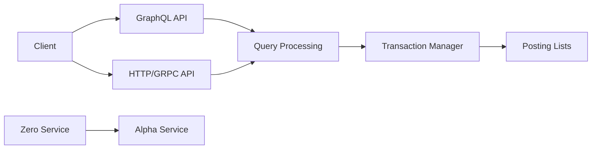

# dgraph-io/dgraph

> Distributed graph database, GraphQL-native, with ACID transactions and replication.

## The problem
Highly connected data (more than ten tables joined by foreign keys, sparse schemas) makes SQL heavy and joins expensive at large scale.

## What it actually does
Stores a sharded and replicated graph; queries in GraphQL syntax, JSON or Protocol Buffers responses over gRPC and HTTP.
Two node types: Zero (coordination, election, groups) and Alpha (data, queries), Raft consensus.
Native full-text, regex and geographic search.
Written in Go, version v25.

## How it is wired


## Trying it
```bash
docker pull dgraph/dgraph:latest
docker run -it -p 8080:8080 -p 9080:9080 -v ~/dgraph:/dgraph dgraph/standalone:latest
```

## Cost and gotchas
Free under Apache-2.0. A real cluster requires several Zero and Alpha nodes to operate. Building from source: Go 1.27+.

## What it is not
Not a vector database nor a RAG tool. The comparison table with Neo4j and JanusGraph is written by the vendor.

## Alternatives
- Neo4j: Cypher, rich ecosystem, but single server in the community edition and GPL v3.
- JanusGraph: Gremlin, relies on an existing distributed database.

## For you
Ignore unless you have a large-scale knowledge graph project: for your usual data uses, the operating cost of a distributed cluster is not justified.
