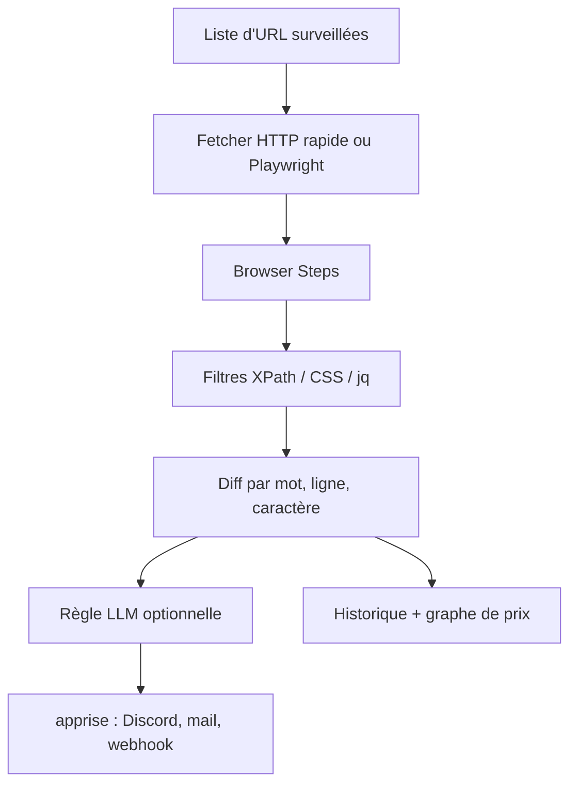

# dgtlmoon/changedetection.io

> Self-hosted web page monitoring with notifications, filters and LLM summaries.

## The problem
A lot of information exists only on a web page: prices, availability, regulatory notices, job offers.
Without monitoring, you discover the change too late, or you reread the page by hand every day.

## What it actually does
Monitors URLs and notifies via Discord, email, Slack, Telegram, webhook and many others through apprise; diff visible by word, line or character.
Fine targeting: XPath 1 and 2, CSS selectors, JSONPath or jq, extraction of JSON-LD embedded in an HTML page, tracking of PDF text, visual selector with a Playwright fetcher.
Browser Steps to log in, click, fill in a form before measuring; restock and price detection with upper/lower thresholds and percentage; scheduling by timezone, day and hour.
Optional LLM layer (via LiteLLM): a natural-language rule to notify only what interests you, and a plain-language summary of the diff.

## How it is wired


## Trying it
```bash
docker run -d --restart always -p "127.0.0.1:5000:5000" -v datastore-volume:/datastore --name changedetection.io dgtlmoon/changedetection.io
```

```bash
pip3 install changedetection.io
changedetection.io -d /path/to/empty/data/dir -p 5000
```

## Cost and gotchas
Self-hosting is free; a hosted subscription at $8.99/month exists, and the visual selector assumes a Playwright fetcher.
The LLM features send diffs and extracted text to a third-party provider: the README makes you responsible for site terms of service, GDPR and the API bill.

## What it is not
It is not a general-purpose scraper: it detects changes, it does not build a dataset.
It is not free of legal questions: the README insists on your responsibility regarding the terms of service and `robots.txt` of the monitored sites.
LLM summaries are not reliable by construction: the README explicitly warns about hallucinations and silent truncations.

## Alternatives
No alternative is named; the README compares itself to unnamed "monitoring services".

## For you
Excellent for automated technical watch (releases, security advisories, regulatory pages) without depending on a SaaS.
