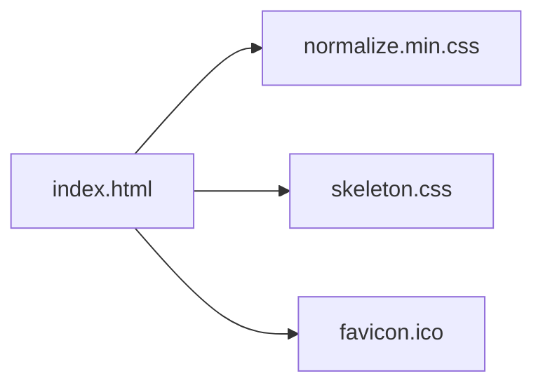

# dhg/Skeleton

> Lightweight CSS boilerplate with a responsive grid, to start a small web project without a framework.

## The problem
Full CSS frameworks are heavy for a simple page.

## What it actually does
About 400 lines of CSS that style raw HTML elements and provide a responsive grid. The download contains `index.html`, `normalize.min.css`, `skeleton.css` and a favicon. No build step. LESS and Sass extensions exist on the community side.

## How it is wired
Simplified diagram based on the sheet, no diagram provided.



## Trying it
```bash
git clone https://github.com/dhg/Skeleton.git
```
The README recommends the zip instead for a stable version.

## Cost and gotchas
Free (MIT). Last push in November 2023. The LESS and Sass extensions are not officially supported.

## What it is not
Not a UI framework: "a starting point", with no components. Little activity today.

## Alternatives
No alternative named in the README.

## For you
Ignore: useful for a static page, but unrelated to data, AI or MLOps and inactive since 2023.
