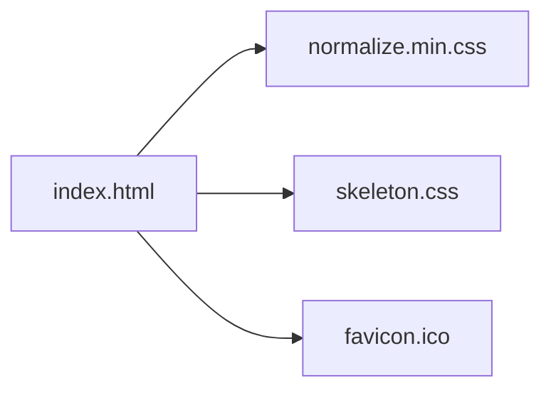

# dhg/Skeleton

> Modèle CSS léger avec grille responsive, pour démarrer un petit projet web sans framework.

## Le problème
Les frameworks CSS complets sont lourds pour une page simple.

## Ce que ça fait vraiment
Environ 400 lignes de CSS qui stylent les éléments HTML bruts et fournissent une grille responsive. Le téléchargement contient `index.html`, `normalize.min.css`, `skeleton.css` et un favicon. Aucune compilation. Des extensions LESS et Sass existent côté communauté.

## Comment c'est branché
Schéma simplifié d'après la fiche, sans diagramme fourni.



## Essayer
```bash
git clone https://github.com/dhg/Skeleton.git
```
Le README recommande plutôt le zip pour une version stable.

## Coût et pièges
Gratuit (MIT). Dernier push en novembre 2023. Les extensions LESS et Sass ne sont pas supportées officiellement.

## Ce que ce n'est pas
Pas un framework d'interface : « un point de départ », sans composants. Peu actif aujourd'hui.

## Alternatives
Aucune alternative nommée dans le README.

## Pour toi
À ignorer : utile pour une page statique, mais sans lien avec data, IA ou MLOps et inactif depuis 2023.

