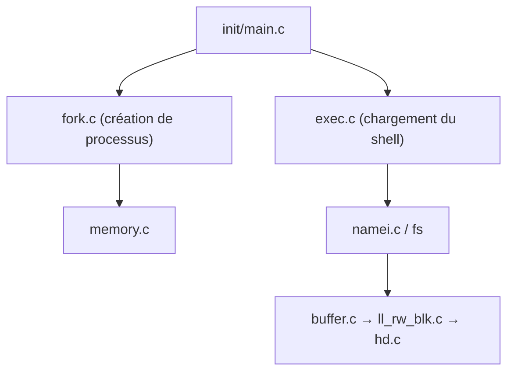

# dibingfa/flash-linux0.11-talk

> Series of Chinese-language articles commenting on the Linux 0.11 kernel code, from boot to the execution of a command.

## The problem
The code of an operating system kernel is hard to approach without a guide.

## What it actually does
A table of contents of 48 chapters in five parts: preparation before the kernel, initialization (memory, interrupts, disk, console), birth of a process (fork), shell startup, then execution of a command (disk reads, signals). The architecture described links init/main.c to fork.c, exec.c, namei.c and the disk drivers.

## How it is wired

## Trying it
No documented command: read the articles in order starting from the "Opening".

## Cost and gotchas
Free to read, no declared license. Articles in Chinese only. Last push in March 2025. A book version ("Linux 源码趣读") is sold separately.

## What it is not
Not a course on current Linux: this is version 0.11 (1991). No tool to run.

## Alternatives
No alternative named in the README.

## For you
Ignore: systems-learning content in Chinese, unrelated to data, AI or MLOps work.
